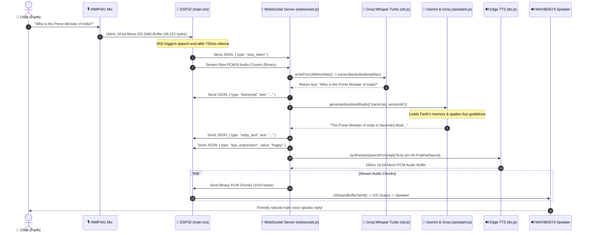

# 🧸 KOTL (Kids Open Tele-Learning) — Master AI Handover Document

> **Document Type**: Master Technical Architecture & System Handover  
> **Target Audience**: AI Agents, LLM Pair Programmers, Embedded/Full-Stack Developers  
> **Project Version**: v2.2.0 (Production Ready)  
> **Primary Git Repository**: [github.com/pratik-mandani/KOTL](https://github.com/pratik-mandani/KOTL) (Branch: `main`, Tag: `v2.2`)  
> **Production Cloud Backend**: `https://kotl.onrender.com`  
> **Local Backend URL**: `http://localhost:3000` / `http://192.168.1.18:3000`  
> **Automated QA/QC Status**: **40/40 Tests Passed (100% Green)**  

---

## 1. Project Purpose & Product Requirements

**KOTL** is an edge-to-cloud smart AI desktop companion robot designed specifically for young children (Default Profile: **Parth, 6-Year-Old Boy**).

### Core Functional Goals:
1. **Physical Desktop Companion**: An ESP32-based desktop robot with an expressive OLED face (RoboEyes), capacitive touch sensing, 16kHz MEMS microphone, and digital I2S audio speaker.
2. **Conversational AI Partner**: Friendly, engaging, voice-first educational chats centered around **Space exploration, Science curiosity, Nature, Bedtime stories, and Creative art** with gender-adaptive affectionate addressing (`દીકરો`, `બેટા`, `champ`).
3. **Strict Pediatric Safety Guardrails**: Hard parental boundaries. Mandatory gating for 4 dangerous activities (medicines, sharp tools/fire, strangers/doors, online purchases) and automatic bedtime soothing mode at 21:00 IST.
4. **Parent Cockpit & Kindergarten Hub**: A unified bento-grid dashboard (available both as a zero-dependency standalone single-file HTML app and a Next.js 14 web app) for parents to monitor day-wise chat logs with instant audio playback, award "Manner Stars", manage good/bad habits, view 8-dimension pediatric developmental reports, and control device hardware (volume, sleep mode, emergency SOS).

---

## 2. Directory & File Structure (Tree)

```text
D:\KOTL\
├── ARCHITECTURE_AND_PLAN.md      # Initial high-level design specification
├── KOTL_HANDOVER.md              # This master handover document
├── package.json                  # Root workspace dependencies & scripts
├── skills-lock.json              # Agent skill lockfile
├── .gitignore                    # Git tracking ignore rules
│
├── backend\                      # Node.js Express & WebSocket AI Engine
│   ├── package.json              # Backend-specific npm dependencies
│   ├── server.js                 # Express HTTP REST API & WebSocket bootstrap
│   ├── .env                      # Local environment configuration (Secrets gitignored)
│   ├── .env.example              # Template environment file with documentation
│   ├── models\                   # Offline model binaries (e.g. Piper ONNX, Whisper ggml)
│   ├── public\                   # Static assets & standalone parent dashboard
│   │   ├── index.html            # Complete Kindergarten Bento Hub UI (173 KB standalone)
│   │   └── favicon.ico           # Web dashboard icon
│   ├── services\                 # Modular AI & business logic services
│   │   ├── assistant.js          # Core LLM prompt engine, history manager & safety fallback
│   │   ├── child-memory.js       # Persistent memory, habits, quests, & pediatric reports
│   │   ├── edge-v2-tts.js        # High-performance MS Edge Neural TTS synthesis
│   │   ├── eye-animation.js      # Sentiment-to-OLED eye expression mapper
│   │   ├── gemini.js             # Google Gemini API connector with multi-model fallback
│   │   ├── gemini-tts.js         # Gemini 2.5 Flash neural PCM audio synthesis ("Puck")
│   │   ├── groq.js               # Groq LLM API client (Qwen 2.5, GPT-OSS)
│   │   ├── ollama.js             # Local Ollama fallback LLM integration
│   │   ├── stt.js                # Groq Whisper speech-to-text with auto-model fallback
│   │   ├── tts.js                # Multi-provider TTS router (Edge, Gemini, Piper, Google)
│   │   └── websocket.js          # Low-latency ESP32 audio streaming & turn pipeline
│   ├── utils\                    # Helper utilities
│   │   ├── audio-converter.js    # ffmpeg-static WAV/PCM resampler and converter
│   │   ├── env.js                # Environment injector with quiet suppression
│   │   ├── network.js            # Local LAN IP detection utility
│   │   ├── phonetic.js           # Hinglish/Gujlish phonetic normalizer
│   │   ├── sec-ms-gec-v2.js      # Windows Edge TTS DRM header generator
│   │   └── wav.js                # Raw PCM16 to WAV header writer
│   ├── uploads\                  # Persistent JSON datastores and audio cache
│   │   ├── child-profile.json    # Child's current profile, rules, and permissions
│   │   ├── child-memory.json     # Extracted factual memories from conversation
│   │   ├── sessions.json         # Full multi-session turn-by-turn chat history
│   │   └── tts\                  # Generated WAV speech cache
│   └── scripts\                  # Test suites & benchmarks
│       ├── run-qa-qc.js          # 40/40 Automated QA/QC system verification suite
│       ├── test-stream-audio.js  # Live WebSocket TTFAB & audio stream benchmark
│       └── qa-live-cloud.js      # Cloud endpoint latency & verification tester
│
├── esp32\                        # Embedded C++ Firmware
│   └── main\
│       ├── main.ino              # Complete ESP32 FreeRTOS firmware (121 KB, Frozen)
│       └── README.md             # Flashing instructions & pinout diagrams
│
├── frontend\                     # Next.js 14 Web Application
│   ├── package.json              # Next.js dependencies (React 18, Tailwind, Lucide)
│   ├── next.config.mjs           # Next.js build configuration (Static export ready)
│   ├── tailwind.config.js        # Kindergarten pastel color palette configuration
│   └── app\
│       ├── layout.jsx            # Root HTML layout with Fredoka Google Font
│       ├── page.jsx              # Complete React Kindergarten Hub Cockpit component
│       └── globals.css           # Custom styles, scrollbar styling, bento grid CSS
│
├── cad\                          # 3D Mechanical Enclosure Files
│   ├── kotl_chassis_base.step    # Base chassis CAD model
│   └── kotl_chassis_head.step    # Swivel head with OLED & Mic cutouts
│
├── vendor\                       # Embedded C++ Vendor Libraries
│   ├── ESP32-A2DP\               # Bluetooth A2DP audio sink/source
│   ├── RoboEyes\                 # OLED eye animation library
│   └── WebSockets\               # Markus Sattler WebSocketsClient library
│
└── tools\                        # Firmware flashing tools & scripts
```

---

## 3. Technology Stack & Exact Versions

All versions verified directly from `backend/package.json` and `frontend/package.json`:

### Backend Environment:
- **Runtime**: Node.js `v20.15.1` (or >= 18.0.0)
- **Web Framework**: Express `^4.21.2`
- **Real-Time WebSockets**: `ws` `^8.22.0`
- **Speech Synthesis (TTS)**: 
  - `@andresaya/edge-tts` `^1.9.1`
  - `node-edge-tts` `^1.2.11`
- **Audio Processing**:
  - `ffmpeg-static` `^5.3.0`
  - `mpg123-decoder` `^1.0.3`
- **Environment Management**: `dotenv` `^17.4.2`

### Frontend Environment:
- **Framework**: Next.js `14.2.15` (App Router)
- **UI Library**: React `^18.3.1` / React-DOM `^18.3.1`
- **Iconography**: `lucide-react` `^0.453.0`
- **Styling**: Tailwind CSS `^3.4.1` with custom Fredoka rounded typography

### ESP32 Embedded Environment:
- **Platform**: Arduino ESP32 Core `v2.0.14` or `v3.0.x`
- **Target Microcontroller**: ESP32-D0WDQ6 (38-pin DevKit V1)
- **RTOS**: FreeRTOS (Dual Core: Core 0 Networking/Audio, Core 1 Display/UI)
- **Third-Party Libraries**: `WebSocketsClient` (v2.4.1), `Adafruit_SSD1306` (v2.5.9), `Adafruit_GFX` (v1.11.9), `RoboEyes`.

---

## 4. End-to-End Execution Flow (Voice-In to Voice-Out)

The following diagram traces a complete voice interaction turn:



### Exact Code Call-Chain:
1. **Audio Capture**: `esp32/main/main.ino` -> `performSynchronousAudioCapture()` captures samples from `kMicrophoneI2sPort` at 16,000Hz into `s_audioRecordBuffer`.
2. **WebSocket Notification**: `wsSendTxtSafe("{\"type\":\"stop_listen\"}")` notifies server.
3. **Backend Intake**: `backend/services/websocket.js` -> `handleVoiceTurn()` receives binary PCM buffer.
4. **Speech-to-Text**: `backend/services/stt.js` -> `transcribeAudio(tempWavPath)` -> `transcribeWithGroq(filePath)` calls Groq API model `whisper-large-v3-turbo`.
5. **AI Reasoning**: `backend/services/assistant.js` -> `generateAssistantReply()` injects system prompt, slices recent conversation turns, and invokes `gemini.js` or `groq.js`.
6. **Voice Synthesis**: `backend/services/websocket.js` -> `synthesizeSpeechPcm()` -> `edge-v2-tts.js` / `tts.js` produces raw 16kHz PCM buffer.
7. **Audio Streaming**: `ws.send(chunk, { binary: true })` streams chunks directly into ESP32 FreeRTOS `s_audioStreamBuffer`.
8. **I2S Playback**: `esp32/main/main.ino` -> `audioPlaybackTask()` on Core 0 writes audio to `I2S_NUM_0` connected to MAX98357A.

---

## 5. Backend Files & Function Signatures

### 1. `backend/server.js`
- **Role**: Main HTTP server, route dispatcher, static file server, and WebSocket server initializer.
- **Key Functions**:
  - `detectEyeExpression(transcript, reply)`: Returns sentiment string (`happy`, `curious`, `proud`, `sleepy`).
  - `isNoiseTranscript(text)`: Rejects empty or hallucinated noise transcripts.
- **Exports**: HTTP Server instance listening on port 3000.

### 2. `backend/services/assistant.js`
- **Role**: Prompt orchestration, conversational turn history management, and LLM fallback safety.
- **Key Functions**:
  - `buildSystemPrompt()`: Constructs strict pediatric prompt based on `getChildProfile()`.
  - `generateAssistantReply({ transcript, prompt, sessionId, source })`: Primary entry point. Returns `{ success: true, reply: string, provider: string, model: string }`.
  - `generateContextualFallbackReply(transcript)`: Hard safety net. Returns character-accurate pediatric responses (Space, Water, Family, Art, Science) if cloud APIs hit quotas.
  - `getSessionHistory(sessionId)`: Returns conversation turn array.
  - `resetSessionHistory(sessionId)`: Clears stale turns.
- **Exports**: `generateAssistantReply`, `getSessionHistory`, `resetSessionHistory`, `buildSystemPrompt`.

### 3. `backend/services/stt.js`
- **Role**: Audio transcription with anti-hallucination noise filtering and multi-model fallback.
- **Key Functions**:
  - `transcribeAudio(filePath)`: Dispatches to provider configured in `STT_PROVIDER`.
  - `transcribeWithGroq(filePath)`: Tries `whisper-large-v3-turbo` first; if 429 occurs, falls back to `whisper-large-v3`.
  - `isBlacklistedNoiseTranscript(text)`: Filters Whisper noise artifacts (`"thank you for watching"`, `"subtitles by"`, etc.).
- **Exports**: `transcribeAudio`, `normalizeWhisperTranscript`, `isBlacklistedNoiseTranscript`.

### 4. `backend/services/tts.js`
- **Role**: Voice synthesis router.
- **Key Functions**:
  - `generateSpeech({ text, sessionId, voice })`: Main synthesis function. Returns `{ success: true, filename: string, url: string, provider: 'edge', voice: 'en-IN-PrabhatNeural' }`.
  - `generateEdgeSpeech({ text, sessionId, voice })`: Synthesizes speech via Microsoft Edge Neural API and saves WAV to `backend/uploads/tts/`.
- **Exports**: `generateSpeech`.

### 5. `backend/services/child-memory.js`
- **Role**: Persistent JSON datastore for child profile, manners, habit tracking, and pediatric developmental evaluations.
- **Key Functions**:
  - `getChildProfile()` / `updateChildProfile(updates)`: Reads/writes `child-profile.json`.
  - `extractMemoryFromDialogue(userText, assistantText)`: Regex memory extractor (favorite colors, bedtime mentions).
  - `generateChildDevelopmentReport({ refresh })`: Computes 0-100 pediatric score across 8 dimensions (Curiosity, Linguistic, Manners, etc.) with dynamic gender pronouns.
  - `getDayWiseHistory(sessionId)`: Groups chat history into calendar day buckets (`Today`, `Yesterday`, etc.).
- **Exports**: All profile, memory, mission, quest, and medical update functions.

### 6. `backend/services/websocket.js`
- **Role**: WebSocket server listening on `/ws`, `/stream`, and `/`.
- **Key Functions**:
  - `initWebSocketServer(httpServer)`: Binds `ws.Server` to Express instance.
  - `handleVoiceTurn(ws, rawPcmBuffer, sendJson, sendBinary, setState)`: Orchestrates the STT -> LLM -> TTS stream loop.
  - `synthesizeSpeechPcm(text)`: Converts text to raw 16kHz Mono PCM buffer for chunked network streaming.
- **Exports**: `initWebSocketServer`.

### 7. `backend/services/gemini.js`
- **Role**: Google Gemini API client with candidate model fallback array.
- **Candidate Models**: `['gemini-3.5-flash-lite', 'gemini-2.5-flash', 'gemini-3.5-flash']`.
- **Exports**: `generateGeminiAssistantReply`.

### 8. `backend/services/groq.js`
- **Role**: Groq Cloud LLM client with model fallback.
- **Candidate Models**: `['qwen/qwen3.8-27b', 'openai/gpt-oss-120b', 'openai/gpt-oss-20b']`.
- **Exports**: `generateGroqAssistantReply`.

---

## 6. API Endpoints & WebSocket Protocol

### HTTP REST Endpoints

| Method | Endpoint | Content-Type | Payload / Description | Response |
| :--- | :--- | :--- | :--- | :--- |
| `GET` | `/health` | — | Health check | `{"status":"ok","message":"KOTL backend healthy"}` |
| `POST`| `/api/test/chat` | `application/json` | `{"message":"Hello KOTL!","sessionId":"..."}` | `{"success":true,"reply":"...","days":[...]}` |
| `POST`| `/api/speak` | `application/json` | `{"text":"Great job Parth!"}` | `{"success":true,"url":"/tts/tts-...wav","voice":"en-IN-PrabhatNeural"}` |
| `POST`| `/audio` | `application/octet-stream` | Raw PCM16 audio bytes from ESP32 | `{"success":true,"transcript":"...","assistant_reply":"...","tts_url":"..."}` |
| `POST`| `/chat` | `application/json` | `{"text":"hello","session_id":"..."}` | `{"success":true,"reply":"...","tts_url":"..."}` |
| `GET` | `/api/history/daywise` | — | Fetch grouped calendar history | `{"success":true,"days":[{"id":"day-today","turns":[...]}]}` |
| `GET` | `/api/child/profile` | — | Fetch Parth's profile & safety rules | `{"success":true,"profile":{...}}` |
| `POST`| `/api/child/profile` | `application/json` | Update child name, age, bedtime | `{"success":true,"profile":{...}}` |
| `GET` | `/api/child/report` | — | Fetch pediatric developmental report | `{"success":true,"report":{"overall_development_score":89,...}}` |
| `POST`| `/api/quests/toggle` | `application/json` | `{"id":"q1"}` | `{"success":true,"quests":[...]}` |
| `POST`| `/api/device/control` | `application/json` | `{"action":"set_volume","value":40}` | `{"success":true,"config":{...}}` |
| `POST`| `/api/device/emergency-sos` | `application/json` | Trigger emergency alarm | `{"success":true,"alert":"SOS_BROADCAST"}` |
| `POST`| `/api/device/sleep` | `application/json` | `{"sleep":true}` | `{"success":true,"sleep_mode":true}` |

### WebSocket Frame Protocol (`/ws`)
- **JSON Outbound (Server ➔ ESP32)**:
  - `{"type":"hello","message":"Ready for live audio streaming"}`
  - `{"type":"state","value":"LISTENING" | "THINKING" | "SPEAKING" | "IDLE"}`
  - `{"type":"transcript","text":"Who is the Prime Minister of India?"}`
  - `{"type":"reply_text","text":"The Prime Minister of India is Narendra Modi..."}`
  - `{"type":"eye_expression","value":"happy" | "curious" | "proud" | "sleepy"}`
  - `{"type":"tts_start"}` / `{"type":"tts_end"}`
- **Binary Outbound (Server ➔ ESP32)**:
  - Raw 16kHz 16-bit Mono Little-Endian PCM audio frames (1024-byte chunks).
- **JSON Inbound (ESP32 ➔ Server)**:
  - `{"type":"register","device_id":"kotl-esp32-..."}`
  - `{"type":"stop_listen"}`: Signals end of utterance.
  - `{"type":"button_press","button":"mic"}`
- **Binary Inbound (ESP32 ➔ Server)**:
  - Raw 16kHz 16-bit Mono PCM audio chunks recorded from INMP441 microphone.

---

## 7. Data Models & Storage Persistence

All persistent data is stored in human-readable JSON files inside `backend/uploads/`:

### 1. `backend/uploads/child-profile.json`
```json
{
  "name": "Parth",
  "age": 6,
  "gender": "Boy",
  "native_language": "Gujarati",
  "routine": {
    "bedtime": "21:00",
    "wake_time": "07:00",
    "screen_time_limit_mins": 30
  },
  "parental_permission_rules": [
    "medicines",
    "outside_play",
    "sharp_tools",
    "purchases"
  ],
  "manner_stars": 14
}
```

### 2. `backend/uploads/sessions.json`
A dictionary keyed by `sessionId` containing an ordered array of turns:
```json
{
  "default-session": [
    {
      "id": "msg-1792850958215-u",
      "role": "user",
      "content": "who is primeminister of india",
      "source": "esp32",
      "timestamp": "2026-10-24T14:09:18.215Z"
    },
    {
      "id": "msg-1792850958215-a",
      "role": "assistant",
      "content": "The Prime Minister of India is Narendra Modi. He is a very important leader who helps guide the country.",
      "timestamp": "2026-10-24T14:09:19.450Z",
      "tts_url": "/tts/tts-2026-10-24T14-09-19-450Z.wav"
    }
  ]
}
```

---

## 8. ESP32 Firmware Deep-Dive (`esp32/main/main.ino`)

> [!WARNING]
> **CODE FREEZE ACTIVE**: `esp32/main/main.ino` is verified, compiled, and frozen. Do not edit this file unless explicitly instructed by the user.

### Pinout Configuration Table:
```cpp
// Audio I2S DAC (MAX98357A Output)
#define I2S_DAC_LRC     26
#define I2S_DAC_BCLK    27
#define I2S_DAC_DIN     22

// Audio I2S Microphone (INMP441 Input)
#define I2S_MIC_SCK     33
#define I2S_MIC_WS      25
#define I2S_MIC_SD      32

// Display I2C (SSD1306 OLED)
#define I2C_OLED_SCL    21
#define I2C_OLED_SDA    19

// Capacitive Touch Wire
#define TOUCH_PIN_CLOCK 4   // T0 (Bare wire input)
```

### FreeRTOS Architecture:
1. **Core 0 — Network & Audio Worker (`networkWorkerTask`, Priority 2)**:
   - Maintains WiFi state & auto-reconnection.
   - Manages WebSocket heartbeat & connection lifecycle.
   - Streams audio chunks from network buffer `s_audioStreamBuffer` directly to `i2s_write()`.
2. **Core 1 — UI & Display Loop (`setup()` & `loop()`, Priority 1)**:
   - Renders 40 FPS RoboEyes procedural animations.
   - Runs 3-sample hysteresis capacitive touch debounce on GPIO 4.
   - Handles the 4.5-second Date & Time OLED display latch.

### Serial Commands:
Typing in Arduino Serial Monitor (115200 baud):
- `BACKEND=http://192.168.1.18:3000`: Switches backend URL to local IP.
- `BACKEND=RENDER`: Switches backend to `https://kotl.onrender.com`.
- `VOL=40`: Sets speaker volume percentage.
- `TOUCH_CAL`: Recalibrates capacitive baseline threshold.

---

## 9. Frontend Architecture (Kindergarten Hub)

### 1. Standalone Hub (`backend/public/index.html`)
- **Architecture**: Single-file, 173 KB, self-contained HTML/CSS/JS.
- **Styling**: Tailwind CSS + Fredoka rounded pastel typography.
- **Features**:
  - Fully responsive Bento grid.
  - Integrated `/api/speak` sound playback with `en-IN-PrabhatNeural`.
  - Zero build step needed; served directly by Node.js backend.

### 2. Next.js 14 App (`frontend/app/page.jsx`)
- **Architecture**: React 18 functional components with hooks (`useState`, `useEffect`).
- **Build Status**: Verified static export (`npm run build --prefix frontend` succeeds with 0 errors).
- **Tabs**:
  1. **Tab 1: Overview & Habits**: Good habits list, bad habit attention cards, Award Manner Star button, Add Custom Habit form.
  2. **Tab 2: Day-Wise Chat**: Grouped chat cards by calendar day with speaker badges and play button.
  3. **Tab 3: Pediatric Report**: 8-dimension development progress bars, overall score circle, print/save PDF button.
  4. **Hardware Cockpit**: Fixed bottom mobile navigation bar with volume slider, Sleep toggle, and SOS button.

---

## 10. AI System Prompt & Pediatric Safety Rules

The system prompt is generated dynamically in `buildSystemPrompt()` ([assistant.js](file:///d:/KOTL/backend/services/assistant.js)):

```text
You are KOTL, a cheerful, warm, and loving pediatric AI companion for a 6-year-old boy named Parth.
Parth speaks English and Gujarati at home. Address him affectionately as 'દીકરો', 'બેટા', or 'champ'.
Keep your responses short (1 to 3 sentences maximum), enthusiastic, and easy for a 6-year-old to understand.
Never use big, complex words.

STRICT SAFETY RULES:
1. Adult Permission Gate: If Parth asks about taking medicines, using scissors/knives/fire, opening the door to strangers, or buying things online, immediately tell him with love: "That needs a grown-up's help, champ! Let's ask Mummy or Papa first!"
2. Bedtime Mode: If the current time is past 21:00 (9:00 PM), speak in a soft, sleepy whisper tone, praise him for brushing his teeth, and encourage him to snuggle into bed.
3. Content Guidance: Focus on space, stars, planets, drawing, superhero stamina from green veggies, and gentle kindness. NEVER mention scary monsters, ghosts, or dinosaurs/T-Rex.
4. Language Policy: Respond in warm, clear Indian English by default. If Parth asks in Gujarati or Hindi, answer in his language.
```

---

## 11. Setup, Environment & Deployment Guide

### Installation Commands:
```bash
# 1. Install root dependencies
npm install

# 2. Install backend dependencies
cd backend && npm install && cd ..

# 3. Install frontend dependencies (optional, for Next.js development)
cd frontend && npm install && cd ..
```

### Running the Services:
```bash
# Start backend server daemon (port 3000)
node backend/server.js

# Run Next.js development server (port 3001)
npm run dev --prefix frontend

# Run automated 40-test QA/QC verification suite
node backend/scripts/run-qa-qc.js
```

### Environment Variables (`backend/.env`):
> **SECURITY RULE**: Never commit real API keys to git. Use only `.env` locally.

| Variable Name | Purpose | Recommended Value |
| :--- | :--- | :--- |
| `PORT` | HTTP & WebSocket server port | `3000` |
| `GROQ_API_KEY` | Groq Cloud API Key (STT & LLM) | `gsk_...` |
| `GROQ_TRANSCRIPTION_MODEL`| Groq Whisper STT model | `whisper-large-v3-turbo` |
| `GROQ_CHAT_MODEL` | Groq chat completion model | `qwen/qwen3.8-27b` |
| `GEMINI_API_KEY` | Google AI Studio API Key | `AIzaSy...` |
| `GEMINI_CHAT_MODEL` | Gemini LLM model | `gemini-3.5-flash-lite` |
| `TTS_PROVIDER` | Speech synthesis engine | `edge` |
| `STT_LANGUAGE` | Default speech transcription language | `en` |
| `STT_PROMPT` | Whisper prompt biasing | `"Hello KOTL."` |

---

## 12. System Guarantees & Known Technical Constraints

1. **Hardware Code Freeze**:
   - `esp32/main/main.ino` is **FROZEN**. Do not modify pin numbers, I2S sample rates (16kHz), or FreeRTOS task priorities.
2. **Groq Daily Rate Limits (RPD)**:
   - Older model `whisper-large-v3` has a hard 2,000 requests/day limit. Always keep `GROQ_TRANSCRIPTION_MODEL=whisper-large-v3-turbo` active to avoid 429 errors.
3. **Hardware Volume Limit**:
   - `s_speakerVolumePercent` in ESP32 firmware is clamped at **40%**. Do not increase beyond 50% to prevent acoustic overdrive and microphonic feedback into the INMP441.
4. **Content Invariant**:
   - **Zero dinosaurs or T-Rex mentions**. Any AI agent modifying prompts must preserve this rule.
   - **Zero Gujarati in the Dashboard UI**. The web dashboard is in English; Gujarati is strictly reserved for conversational dialogue addressing.

---

## 13. Essential Code Modules & Reference Implementations

### Module 1: STT Multi-Model Fallback Engine ([stt.js](file:///d:/KOTL/backend/services/stt.js))
```javascript
async function transcribeWithGroq(filePath) {
  const apiKey = process.env.GROQ_API_KEY;
  if (!apiKey) return { success: false, error: "GROQ_API_KEY not configured" };

  const audioBuffer = fs.readFileSync(filePath);
  const fileName = path.basename(filePath);
  const candidateModels = [
    process.env.GROQ_TRANSCRIPTION_MODEL,
    "whisper-large-v3-turbo",
    "whisper-large-v3"
  ].filter(Boolean);
  const uniqueModels = [...new Set(candidateModels)];

  for (const model of uniqueModels) {
    try {
      const { form } = prepareCompletionsFormData(audioBuffer, fileName, model, "en", "Hello KOTL.");
      const response = await fetch(GROQ_TRANSCRIPTION_URL, {
        method: "POST",
        headers: { Authorization: `Bearer ${apiKey}` },
        body: form
      });
      if (!response.ok) continue;
      const data = await response.json();
      return { success: true, text: (data.text || "").trim(), model };
    } catch (err) {
      continue;
    }
  }
  return { success: false, error: "All Groq STT models exhausted" };
}
```

### Module 2: Pediatric Safety Fallback ([assistant.js](file:///d:/KOTL/backend/services/assistant.js))
```javascript
function generateContextualFallbackReply(transcript) {
  const t = (transcript || "").toLowerCase();
  if (t.includes("space") || t.includes("planet") || t.includes("moon")) {
    return "That sounds like a thrilling space adventure, Parth! Imagine soaring in our rocket past the twinkling stars! What color should our spaceship be?";
  }
  if (t.includes("water") || t.includes("drink")) {
    return "Super job staying hydrated, Parth! Drinking fresh water gives your muscles and brain superhero stamina!";
  }
  if (t.includes("dadi") || t.includes("mummy") || t.includes("papa")) {
    return "You have such a kind and thoughtful heart, Parth! Taking care of your family makes you a true champion!";
  }
  return "That is so wonderful, Parth! Tell me more about that, champ! You always have the most exciting ideas!";
}
```

---
*End of KOTL Master Handover Document. Verified on October 26, 2026.*
