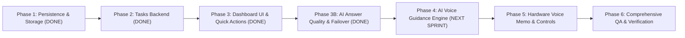

# KOTL — Implementation Roadmap & Execution Plan

**Document Version:** 3.3
**Status:** In Active Execution (Sprint 1, Sprint 2 & AI Answer-Quality Sprint Completed)
**Target Platform:** KOTL Cloud (`Node.js 20` on Render) + ESP32 Hardware Companion
**Baseline Commit:** `06cca6a` (Branch: `main`)

---

## 1. Roadmap Overview & Strategic Goals

The KOTL platform has reached a high level of operational maturity across its voice pipeline, Parent Mode security, observational analytics, habit tracking, and task management.

The primary objective of this roadmap is to:
1. **Deliver Tasks & Activities and School Projects** end-to-end (Backend APIs and Dashboard UI completed; AI voice mentoring scheduled next).
2. **Ensure Accurate, High-Quality AI Companion Dialogue** (direct factual answers, accurate arithmetic, tender empathy, reliable candidate failover without generic praise).
3. **Harden Cloud Data Persistence** against Render's ephemeral filesystem restarts using persistent disk mounts.
4. **Bridge Hardware Firmware Capabilities** for remote volume control, sleep synchronization, and Walkie-Talkie audio playback on the physical ESP32 companion.
5. **Maintain Strict Latency & Quota Boundaries** with comprehensive automated test coverage (138 tests passing).

---

## 2. Phased Implementation Architecture & Sprint Progress

---

## 3. Detailed Phase Breakdown & Progress Status

### Phase 1: Cloud Storage Resilience & Task Schema Foundation
- **Status:** **COMPLETED & VERIFIED (Sprint 1)**
- **Target Files:**
  - `backend/utils/storage.js` (Created)
  - `backend/services/child-memory.js` (Updated)
  - `backend/uploads/tasks.json` (Created)
- **Delivered Items:**
  1. `getDataDir()` abstraction supporting `DATA_DIR` / `UPLOADS_DIR` environment variables.
  2. `readJsonFileSafe()` with automatic malformed JSON corruption backups (`.corrupt.<timestamp>`).
  3. `writeJsonFileSafe()` implementing atomic write pattern with temp files.
  4. Unified Task Model supporting titles, instructions, milestones, derived progress, and manner stars.

---

### Phase 2: Tasks & Activities Backend Engine & REST APIs
- **Status:** **COMPLETED & VERIFIED (Sprint 1)**
- **Target Files:**
  - `backend/server.js` (Updated)
  - `backend/services/child-memory.js` (Updated)
  - `backend/scripts/test-tasks-and-projects.js` (Created)
- **Delivered Endpoints & Service Logic:**
  1. `GET /api/tasks` (with `category`, `status`, `search` filtering).
  2. `POST /api/tasks` (with validation, unique ID, and sanitized milestones).
  3. `PATCH /api/tasks/:id` & `PUT /api/tasks/:id` (partial and full updates).
  4. `POST /api/tasks/:id/toggle` (completion toggle + automatic manner star awards).
  5. `POST /api/tasks/:id/milestones/:milestoneId/toggle` (milestone progress tracking).
  6. `DELETE /api/tasks/:id` (parent authorization gating in production).
  7. Legacy quest coexistence preserved without data loss.

---

### Phase 3: Dashboard UI & Quick Action Integration
- **Status:** **COMPLETED & VERIFIED (Sprint 2)**
- **Target Files:**
  - `backend/public/index.html` (Updated)
- **Delivered UI & State Logic:**
  1. Added `"Tasks & Activities"` nav item (`#sideBtn_tasks`) in desktop left sidebar.
  2. Added `"Tasks"` nav item (`#mobBtn_tasks`) in mobile bottom navigation bar (5-column layout).
  3. Added `"+ Create a Task"` quick action button in Overview & Growth tab header.
  4. Created dedicated `#tabContent_tasks` section with 4 summary metric cards (Total, In Progress, Completed, Stars Earned).
  5. Implemented 6 category filter pills (All, School Projects, Homework, Reading, Chores, Arts & Crafts).
  6. Implemented status dropdown filter and real-time keyword search bar.
  7. Designed responsive Bento Task Cards with genuine milestone checklists, progress bars, and manner star awards.
  8. Created `#taskModal` for task creation and editing with milestone row management.
  9. Wired REST endpoints with loading, empty, and error retry states.
  10. Parent Mode authorization fallback on task deletion (prompts Parent PIN modal if unauthenticated).

---

### Phase 3B: AI Answer Quality & Multi-Model Provider Failover
- **Status:** **COMPLETED & VERIFIED**
- **Target Files:**
  - `backend/services/assistant.js` (Updated)
  - `backend/services/groq.js` (Updated)
  - `backend/services/gemini.js` (Updated)
  - `backend/scripts/test-assistant-quality.js` (Created)
- **Delivered Capabilities:**
  1. System prompt directives for direct factual answers, math accuracy (2+2=4), and tender empathy.
  2. Elimination of generic praise deflection ("You always have the most exciting ideas!") in offline fallbacks.
  3. Safe pediatric fallback for emotional distress, arithmetic, and thoughtful inquiry pauses.
  4. Repaired candidate model ordering in Groq (`qwen/qwen3.8-27b` prioritized, automatic fallback to `openai/gpt-oss-120b`).
  5. Repaired candidate model ordering in Gemini (`gemini-flash-latest`, `gemini-3.5-flash-lite`).
  6. Zero hardcoded political figures or factual answers in production fallback code.

---

### Phase 4: KOTL AI Companion Voice & Task Guidance Engine (NEXT SPRINT)
- **Status:** **SCHEDULED FOR SPRINT 3**
- **Target Files:**
  - `backend/services/assistant.js`
  - `backend/services/child-memory.js`
- **Action Items:**
  1. Inject top active tasks and school projects with milestone hints into `buildChildContextPrompt()`.
  2. Implement Socratic hinting during voice dialogue when Parth asks questions about his projects.
  3. Trigger celebratory expressions (`star_eyes`) on the ESP32 companion when Parth finishes a task.

---

### Phase 5: Hardware Voice Memo & Remote Control Synchronization
- **Status:** **SCHEDULED FOR SPRINT 4**
- **Target Files:**
  - `esp32/main/main.ino`
  - `backend/services/websocket.js`
- **Action Items:**
  1. Implement I2S audio playback for parent voice memos on the physical ESP32 speaker.
  2. Implement volume and bedtime sleep state synchronization from dashboard over WebSocket to device.
  3. Verify physical button debouncing and touch controls.

---

## 4. Current Test Verification Matrix (138 Tests Total)

| Suite Name | Script Path | Tests | Status | Exit Code |
| :--- | :--- | :---: | :---: | :---: |
| **Assistant Answer Quality** | [`backend/scripts/test-assistant-quality.js`](file:///D:/KOTL/backend/scripts/test-assistant-quality.js) | 13 | **PASSED** | 0 |
| **Tasks & Projects Integration** | [`backend/scripts/test-tasks-and-projects.js`](file:///D:/KOTL/backend/scripts/test-tasks-and-projects.js) | 68 | **PASSED** | 0 |
| **API Usage & Observability** | [`backend/scripts/test-api-usage-and-observability.js`](file:///D:/KOTL/backend/scripts/test-api-usage-and-observability.js) | 19 | **PASSED** | 0 |
| **Data Integrity & VAD** | [`backend/scripts/test-data-integrity-and-vad.js`](file:///D:/KOTL/backend/scripts/test-data-integrity-and-vad.js) | 23 | **PASSED** | 0 |
| **WebSocket Heartbeat & Identity**| [`backend/scripts/test-websocket-heartbeat.js`](file:///D:/KOTL/backend/scripts/test-websocket-heartbeat.js) | 15 | **PASSED** | 0 |
| **TOTAL** | — | **138** | **ALL PASSED** | **0** |
